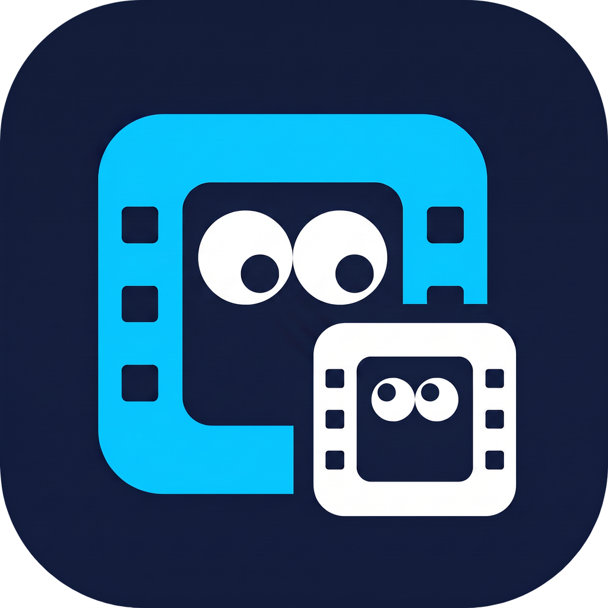

<p align="center">
  
</p>

<p align="center">
  <b>Drag, drop, done – lightweight proxies that DaVinci Resolve links automatically.</b><br>
  Windows 11 · macOS (Apple Silicon) · standalone, no Python required
</p>

---

## What it does

**MiniMe – Proxy Maker** (formerly just "Proxy Maker") turns camera originals into small edit-friendly proxy files written
into a `Proxy` folder next to each source file. Because proxies keep the
**same name, timecode and frame rate**, DaVinci Resolve picks them up
automatically.

## Features

- **Resolve-ready output** – `Proxy/` subfolder, same file name (`.mov`),
  identical timecode and frame rate; or all in one folder with the source
  structure recreated.
- **Sensible size** – 1:4 (quarter, default), 1:2 (half) or 1:1 (full)
  resolution, chosen in Settings, never below a minimum you choose (640×360,
  960×540 default, 1280×720, 1920×1080 or custom; width and height checked
  separately). Aspect ratio preserved, nothing upscaled.
- **Codecs** – ProRes 422 Proxy (default), DNxHR LB, CineForm or light H.264;
  selectable globally and per file. Container is always MOV.
- **Audio untouched** – PCM, AAC and ALAC copied bit-exact; everything else
  becomes 24-bit PCM. All tracks kept.
- **Metadata** – colour tags (BT.709 / BT.2020 / HLG / PQ) copied from the
  source, plus origin fields (app and FFmpeg version, encoder, decoder, source
  file, creation date).
- **RAW formats** – RED **R3D** via REDline (if installed); Blackmagic **BRAW**
  via the Blackmagic RAW SDK (compiled in at build time); Apple **ProRes RAW**
  with automatic white balance; plus everything FFmpeg can read (Sony XAVC,
  H.264/H.265, ProRes, DNx, …).
- **Fast** – four encodes in parallel (max. two RAW at once), GPU decoding and
  hardware encoders where available (VideoToolbox, NVENC, QSV, AMF) with CPU
  fallback, and a 🌿 Gentle / ⚡ Maximum priority switch.
- **Watch folders** – new clips in chosen folders are rendered automatically
  once they finish copying.
- **Long jobs** – disk space check, keeps the computer awake while rendering,
  optional sleep or shut down when finished.
- **Update notification** – tells you when a new release is on GitHub (can be
  switched off; nothing downloaded automatically).
- **Progress everywhere** – per-file and total progress, Windows taskbar and
  macOS Dock progress, notification bounce/flash when the queue finishes.
- **Minimal UI** – Rainbow, Light and Dark themes (follows the system), German
  and English (follows the system), live CPU / GPU / network / disk graphs.

## Download

Prebuilt binaries are attached to the [Releases](../../releases) page when
available. CI builds do **not** include BRAW support (the Blackmagic RAW SDK is
not available to the CI runners and is not part of this repository); build
locally with the SDK installed for BRAW.

> The macOS app is ad-hoc signed only. On first launch, right-click the app →
> **Open**, or remove the quarantine flag:
> `xattr -dr com.apple.quarantine "MiniMe.Proxy.Maker.1.0.3.app"` (use your version)

## Building

Both scripts download FFmpeg once into `ffbin/` (re-download with the
`update` argument), create a private virtual environment in `.venv-build/`
and produce a single standalone app in `dist/`.

### Windows 11

Requirements: Python 3.10+ (python.org installer with the `py` launcher).
For BRAW support additionally: Visual Studio Build Tools (C++ workload) and the
Blackmagic RAW SDK.

```bat
scripts\build_windows.bat
```

Result: `dist\MiniMe.Proxy.Maker.<version>.exe`, e.g. `MiniMe.Proxy.Maker.1.0.3.exe`

### macOS (Apple Silicon)

Requirements: Python 3.10+ (e.g. via Homebrew) and the Xcode Command Line Tools
(`xcode-select --install`). For BRAW support additionally the Blackmagic RAW SDK.

```bash
bash scripts/build_mac.command
```

Result: `dist/MiniMe.Proxy.Maker.<version>.app`, e.g. `MiniMe.Proxy.Maker.1.0.3.app`

### BRAW support

If the Blackmagic RAW SDK is found at build time, the helper in `native/brawpipe/`
is compiled and bundled together with the SDK runtime. The scripts look in
`braw_sdk/` in the repository root, or the default SDK install location
(`/Applications/Blackmagic RAW/…/Mac` on macOS,
`C:\Program Files (x86)\Blackmagic Design\…\Win` on Windows). The build log
ends with a line saying whether BRAW was included.

### RED R3D support

R3D files are decoded with RED's free **REDline** command-line tool (part of
REDCINE-X PRO). It is not bundled; MiniMe finds it automatically when it
is installed in its default location.

## Running from source

```bash
python -m venv .venv
source .venv/bin/activate          # Windows: .venv\Scripts\activate
pip install -r requirements.txt
PYTHONPATH=src python -m proxymaker   # Windows: set PYTHONPATH=src && python -m proxymaker
```

FFmpeg must be on your `PATH` (or in `ffbin/`) when running from source.

## Repository layout

```
assets/            logo and icon (optional log animation is git-ignored)
docs/              additional documentation
native/brawpipe/   C++ helper that decodes BRAW via the Blackmagic SDK
scripts/           build scripts for Windows and macOS
src/proxymaker/    application source (PySide6)
.github/workflows/ CI build for Windows and macOS
```

## License

MiniMe is released under the [MIT License](LICENSE).

The built application bundles third-party software under their own licenses:

- **FFmpeg** – the bundled `ffmpeg.exe` is the "essentials" build from
  [gyan.dev](https://www.gyan.dev/ffmpeg/builds/), licensed under **GNU GPL
  v3** (built with `--enable-gpl --enable-version3`). It runs as a separate
  program, not linked into MiniMe. Source: <https://ffmpeg.org/download.html>;
  build config and corresponding source: <https://www.gyan.dev/ffmpeg/builds/>.
- **[Qt for Python / PySide6](https://www.qt.io/qt-for-python)** – LGPLv3.
- **Blackmagic RAW SDK runtime** – only in builds made on a machine where the
  SDK is installed (such builds include the SDK's runtime libraries, used under
  the Blackmagic RAW SDK license; the SDK itself – headers, samples, tools – is
  **not** part of this repository or its releases). Builds without the SDK have
  no BRAW support.
- **REDline** is used if installed but never bundled.

DaVinci Resolve, Blackmagic RAW, RED, R3D, ProRes and other names are trademarks
of their respective owners. This project is not affiliated with them.

## Contact

STEEPTWO Schwer & Sonnabend GbR · <hello@steeptwo.com>
